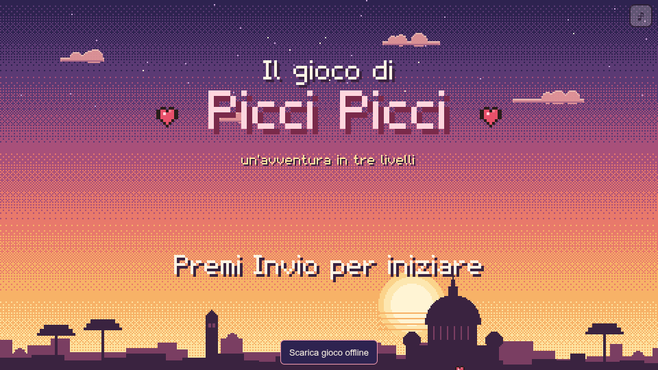
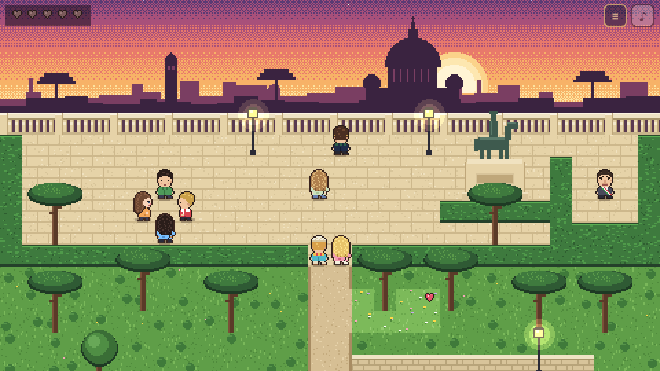
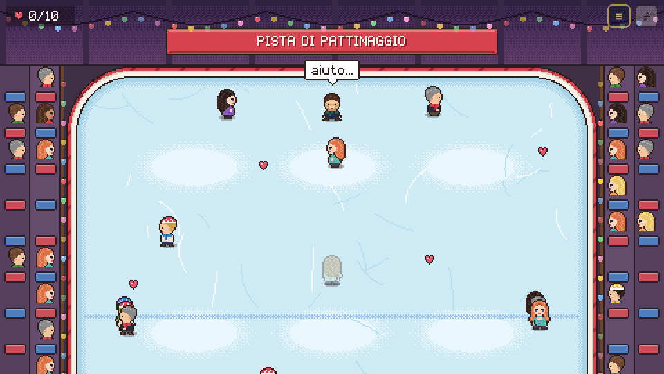
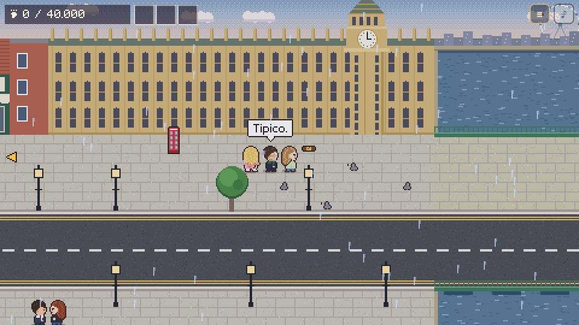
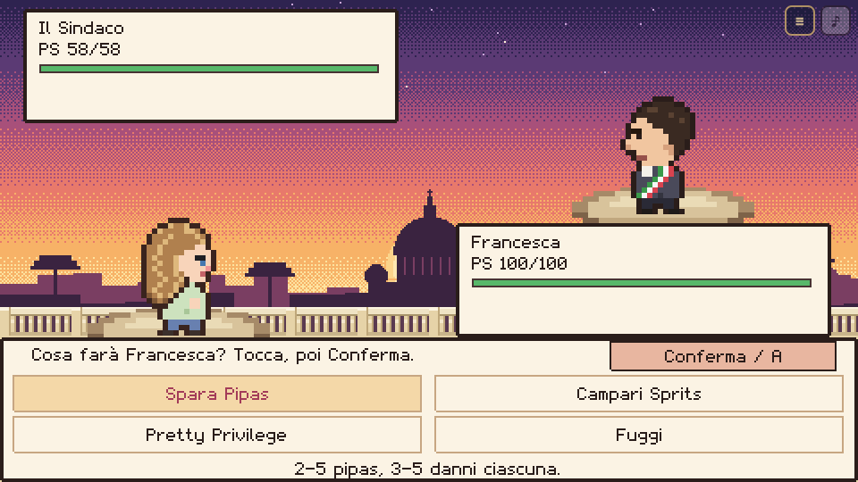
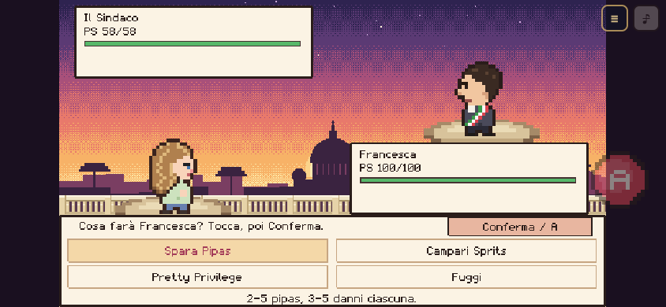

<div align="center">

# Il gioco di Picci Picci ♥

**Un regalo di compleanno di Simone per Francesca.**

Roma al tramonto, una pista un po' scivolosa e quarantamila passi a Londra.

Pixel art · Tre livelli · Dialoghi in italiano · Comandi touch · Gioco offline



[Apri il gioco](https://armidon1.github.io/FrancyGame/) · [Installa sul telefono](#installare-sul-telefono) · [Gioca offline](#giocare-offline) · [Avvio locale](#avvio-locale)

*Il link web è disponibile quando il sito è attivo. Le copie già scaricate possono continuare a giocare offline.*

</div>

## Una piccola avventura, tre ricordi

Un gioco browser dall'alto, ispirato ai giochi di ruolo dell'epoca Game Boy: Francesca esplora, parla con i personaggi, raccoglie cuoricini e ritrova Simone nei posti della loro storia. Ci sono sfide a ninja, battaglie a turni e qualche battuta che ha senso soprattutto per loro due.

| Livello | Il viaggio | Cosa si fa |
| --- | --- | --- |
| **1 · Il Gianicolo** | Dai vicoli di Trastevere alla terrazza su Roma. | Si raccolgono cinque cuoricini, si ritrova una panchina speciale e si sfida Simone a ninja. Gli altri personaggi propongono anche lotte facoltative. |
| **2 · La pista di pattinaggio** | Ghiaccio, festoni e un orsacchiotto da recuperare. | Si pattina con inerzia, si evitano gli altri pattinatori e si raccolgono dieci cuoricini. Se si cade, si riparte dal checkpoint. |
| **3 · Londra, 40.000 passi** | Harrods, parchi, Buckingham Palace, Big Ben, Tamigi e casa degli zii. | Simone segue Francesca. Si raccolgono l'orsetto di Londra, un caffè da sei sterline e una tazza di tè. Il contapassi sale; i piedi protestano. |

La storia prosegue con una sera londinese e una sorpresa finale. Quella conviene scoprirla giocando.

### Cartoline dal gioco

| Roma ai tuoi piedi | Sul ghiaccio si scivola |
| :---: | :---: |
|  |  |
| **Londra, un passo dopo l'altro** | **Una sfida molto seria al Sindaco** |
|  |  |

Le immagini sono schermate reali del gioco. Aprile per vederle a grandezza intera.

## Come si gioca

Avvicinati a un personaggio o a un oggetto, guardalo e premi **A** quando compare **!**. Nei dialoghi, una pressione completa il testo e la successiva avanza.

| Azione | Smartphone | Tastiera | Controller standard |
| --- | --- | --- | --- |
| Muoversi o scegliere una risposta | Croce direzionale | Frecce oppure WASD | Croce o levetta sinistra |
| Interagire, avanzare, confermare | Pulsante **A** | Spazio o Invio; anche Z/X | A o X |
| Aprire il menu di pausa | Pulsante **☰** | Esc | Start o Select |
| Audio | Pulsante **♪** | Pulsante a schermo | Pulsante a schermo |

Su telefono si gioca **in orizzontale**. In verticale compare l'avviso di rotazione.

- **Esplorazione:** croce e A rimangono alla stessa altezza.
- **Dialoghi:** la croce sparisce e rimane A, per lasciare leggibile il testo.
- **Risposte da scegliere:** torna anche la croce.
- **Battaglie:** tocca una mossa per selezionarla, poi premi A o **Conferma**. La croce è nascosta e A rimane sopra il pannello delle mosse.

<details>
<summary><strong>Guarda i comandi durante una battaglia su mobile</strong></summary>



</details>

### Due modi di viaggiare

**Viaggio** è la modalità rilassata. **Arduo** aggiunge PS che restano tra le lotte e uno zaino di spuntini per recuperare energie: pipas, yogurt greco, taralli e torta rustica. A Londra può combattere anche Simone.

La modalità si sceglie iniziando una nuova partita. Non c'è game over: si può riprovare, e le sfide agli NPC sono facoltative.

### Salvataggi, musica e schermo TV

Il gioco ricorda il **livello raggiunto** sul dispositivo tramite `localStorage`: dal titolo si può scegliere **Continua**. Non è un salvataggio della posizione esatta sulla mappa. In Arduo vengono conservati anche PS e zaino.

L'audio parte dopo il primo tocco o input. Si può scegliere tra le musichette generate con Web Audio e le basi configurate in `local/songs.js`. Il tasto ♪ silenzia l'audio. Dal menu si può attivare o disattivare l'effetto **Schermo TV**.

## Installare sul telefono

Apri il link completo del gioco nel browser, anziché nel visualizzatore interno di una chat. Aggiungere l'icona e scaricare il gioco offline sono **due passaggi distinti**.

### iPhone e iPad

1. Apri il sito in **Safari**.
2. Tocca **Condividi → Aggiungi alla schermata Home**.
3. Se compare **Apri come app web**, lascialo attivo.
4. Avvia il gioco **dalla nuova icona**, poi gira il telefono in orizzontale.
5. Per conservarlo senza Internet, esegui il download descritto sotto **da questa stessa icona**.

Il popup Apple nel gioco ricorda la procedura. Avviandolo dalla Home spariscono le barre di Safari. [Documentazione WebKit](https://webkit.org/blog/17333/webkit-features-in-safari-26-0/#every-site-can-be-a-web-app-on-ios-and-ipados).

### Android

1. Apri il sito in **Chrome**.
2. Tocca **⋮ → Installa e crea scorciatoia → Installa**. In alcune versioni il percorso è **Aggiungi alla schermata Home → Installa**.
3. Segui le istruzioni e avvia il gioco dalla nuova icona.
4. Completa il download offline descritto sotto.

I nomi delle voci possono cambiare con la versione di Chrome. [Guida di Google](https://support.google.com/chrome/answer/9658361?co=GENIE.Platform%3DAndroid&hl=it).

## Giocare offline

Il download salva sul dispositivo **tutti i livelli, gli sprite, le musiche e Phaser**. Dopo una copia completa, il gioco può partire anche se il sito è disattivato.

1. Con il sito ancora online, apri il gioco dall'icona installata.
2. Nel titolo o nel menu di pausa, tocca **Scarica gioco offline**.
3. Tocca **Scarica tutto** e tieni aperta la finestra fino alla conferma **Pronto per giocare offline!**.
4. Chiudi il gioco, attiva la **modalità aereo** e riaprilo dall'icona. Prova anche ad avviare un livello.

Se manca un file o il download si interrompe, non viene data la conferma: puoi riprovare. Un aggiornamento incompleto lascia disponibile la copia precedente.

Conserva l'icona e i dati del sito. Se cambi telefono, cancelli i dati o il sistema li elimina, occorrerà scaricare di nuovo il gioco mentre il sito è online. Il gioco richiede spazio persistente quando il browser lo permette, ma la conservazione non è garantita per sempre. [Politica di archiviazione WebKit](https://webkit.org/blog/14403/updates-to-storage-policy/).

### Distribuzione temporanea e aggiornamenti

Simone può tenere il sito online durante l'installazione degli amici, aspettare che tutti abbiano completato **download e prova in modalità aereo**, poi disattivare GitHub Pages e rendere privato il repository.

Per nuovi amici o nuovi telefoni, basta ripubblicare temporaneamente il gioco **allo stesso indirizzo**. Per aggiornare una copia già installata, apri la finestra offline e tocca **Controlla aggiornamenti** mentre il sito è online; attendi la conferma e chiudi e riapri il gioco. I salvataggi restano sul dispositivo.

La visibilità del repository e quella del sito sono impostazioni distinte: verifica sempre lo stato di Pages. La disponibilità di Pages per repository privati dipende dal piano GitHub. [Documentazione GitHub](https://docs.github.com/en/pages/getting-started-with-github-pages/configuring-a-publishing-source-for-your-github-pages-site).

La procedura completa e le note tecniche sono in [OFFLINE.md](OFFLINE.md).

## Avvio locale

È un sito statico: **non servono npm, un bundler o una compilazione per giocare**. Il primo caricamento online usa Phaser 4 da CDN; il download offline conserva anche quel file.

Dalla cartella del progetto:

```sh
python3 -m http.server 8000 --bind 127.0.0.1
```

Apri [http://localhost:8000](http://localhost:8000). Mantieni il terminale aperto; **Ctrl+C** ferma il server.

### Prova da smartphone sulla rete locale

Collega telefono e computer alla stessa rete Wi-Fi. Trova l'indirizzo Wi-Fi del computer; su Linux puoi usare:

```sh
ip -4 -brief address
```

Avvia il server collegandolo a quell'indirizzo. Nell'esempio seguente **sostituisci `192.168.1.42` con l'IP del tuo computer**:

```sh
python3 -m http.server 8000 --bind 192.168.1.42
```

Sul telefono apri `http://192.168.1.42:8000`. Il computer deve restare acceso e il firewall deve consentire l'accesso alla porta 8000 dalla rete locale. Non occorrono tunnel o aperture di porte sul router.

**Il download offline richiede HTTPS oppure localhost.** L'indirizzo HTTP sulla rete Wi-Fi permette di provare il gioco sul telefono, ma non di installarne la copia offline. Per quella prova usa il sito HTTPS pubblicato.

### Accesso rapido ai livelli

| URL locale | Schermata |
| --- | --- |
| `http://localhost:8000/?level=title` | Titolo |
| `http://localhost:8000/?level=1` | Gianicolo |
| `http://localhost:8000/?level=2` | Pista di pattinaggio |
| `http://localhost:8000/?level=3` | Londra |
| `http://localhost:8000/?level=notte` | La sera londinese |
| `http://localhost:8000/?level=finale` | Finale |

Per provare l'interfaccia touch sul computer, aggiungi `&touch=1`; `&touch=0` la nasconde. Nel titolo, una pressione di tre secondi sul nome del gioco o il tasto **L** apre il selettore nascosto. Entrare in un livello di prova può cambiare il livello salvato in quel browser.

## Struttura e tecnologia

```text
index.html                 Pagina, stile e comandi touch
src/                       Scene e sistemi del gioco
  main.js                  Configurazione e avvio di Phaser
  controls.js              Tastiera, touch, controller e visibilità dei comandi
  dialog.js                Dialoghi e ritratti
  audio.js                 Musica, effetti e programmazione delle note
  Level1Scene.js           Gianicolo e ninja
  Level2Scene.js           Pattinaggio
  Level3Scene.js           Londra
  gianicoloBattle.js       Battaglie a turni, anche a Londra
  toiletBattle.js          Lotta della sera londinese
  offline.js               Finestra di download e verifica
assets/                    Sprite e icone
local/                     Configurazione delle basi audio e file musicali
manifest.webmanifest       Nome, icone e modalità dell'app installata
sw.js                      Download, verifica e apertura dalla copia offline
offline-manifest.json      Elenco e impronte dei file da scaricare
tools/                     Generazione dell'elenco offline, screenshot e strumenti audio
tests/                     Verifiche automatiche e istruzioni manuali
docs/screenshots/          Immagini reali usate in questo README
```

- **Phaser 4.0.0** caricato da CDN, con script JavaScript classici.
- Risoluzione interna **480 × 270**, pixel nitidi, ridimensionamento proporzionale con `FIT` e centratura.
- Tile da **16 × 16** e mappe scritte nel codice; sprite principali con frame da **16 × 22**.
- Grafica, ambienti, font ed effetti costruiti in codice; sprite dei protagonisti in `assets/`.
- **Web Audio** per suoni e musichette; basi configurate in `local/songs.js`.
- **localStorage** per i progressi; **Service Worker e Cache Storage** per il gioco offline.

## Pubblicazione e manutenzione

Quando cambi HTML, codice, immagini o musiche, rigenera l'elenco offline **prima di pubblicare**:

```sh
node tools/build-offline.cjs
node tools/build-offline.cjs --check
```

Includi nel commit anche `offline-manifest.json`. Il controllo confronta le impronte dei file; non occorre rigenerarlo per una modifica al solo README o alle immagini della documentazione.

Per pubblicare da questo repository: **Settings → Pages → Deploy from a branch → main → /(root)**, quindi salva. Il file `.nojekyll` è già presente. [Istruzioni ufficiali](https://docs.github.com/en/pages/getting-started-with-github-pages/configuring-a-publishing-source-for-your-github-pages-site).

Il download offline è esplicito: aggiungere l'icona, aprire il sito o registrare il service worker non equivale ad aver scaricato tutto. Prima di disattivare Pages, verifica sempre la conferma e l'avvio senza rete su ciascun telefono.

### Test

Le verifiche senza dipendenze richiedono Node.js:

```sh
node tests/gianicoloBattle.test.cjs
node tests/audio-scheduling.test.cjs
node tools/build-offline.cjs --check
```

| Test browser opzionale | Cosa verifica | Requisiti |
| --- | --- | --- |
| `node tests/gianicoloBattle.browser.cjs` | Interazioni al Gianicolo, battaglie, mosse, fuga e cambio scena. | Server locale attivo, Chromium e `puppeteer-core`. |
| `node tests/mobile-controls.browser.cjs` | Dialoghi con A, scelte con croce, mosse touch, pausa e ripristino dei comandi; tre dimensioni di schermo. | Server locale attivo, Chromium e `playwright-core`. |
| `node tests/offline.browser.cjs` | Download fallito e riprovato, aggiornamento incompleto, sito con risposta 404, scene e musiche senza rete, conservazione dei progressi. | Chromium e `playwright-core`; avvia da sé un server temporaneo su localhost. |

`PLAYWRIGHT_PATH` e `PUPPETEER_PATH` possono indicare una libreria già disponibile; `CHROME_PATH` seleziona il browser. I primi due test browser accettano `GAME_URL` per cambiare l'indirizzo del server. Queste librerie servono soltanto ai test e agli screenshot, non per giocare.

I test con touch simulato non sostituiscono una prova su iPhone e Android reali. Per i dettagli delle battaglie e delle verifiche precedenti, vedi [tests/README.md](tests/README.md).

### Aggiornare le immagini del README

Con Chromium e `playwright-core` già disponibili:

```sh
node tools/capture-screenshots.cjs
```

Lo script avvia un server temporaneo solo su localhost, apre il gioco e salva sei PNG in `docs/screenshots/`. Utilizza un profilo browser isolato e non cambia i salvataggi personali o il codice del gioco. Le schermate sono catturate con l'effetto TV spento per rendere leggibile la pixel art.

---

*Per Francesca, da Simone. — il tuo orsacchiotto ♥*
